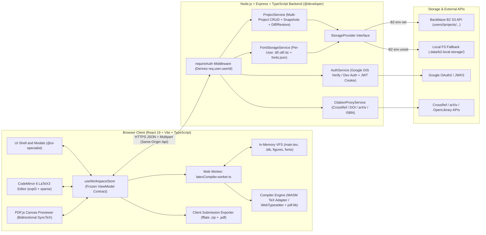
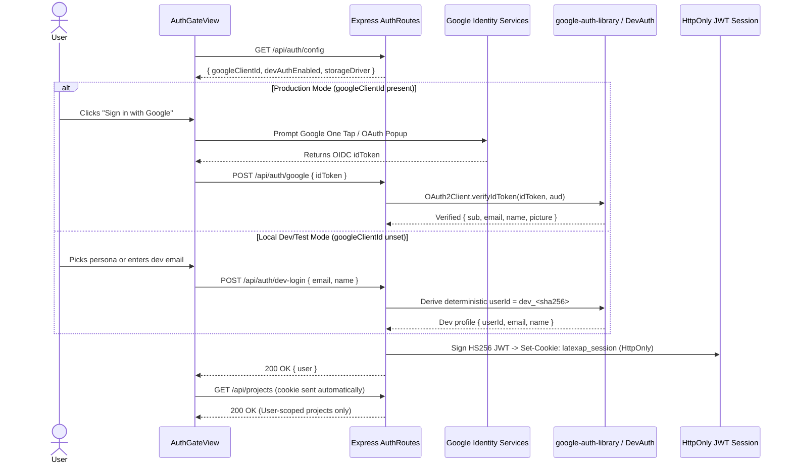
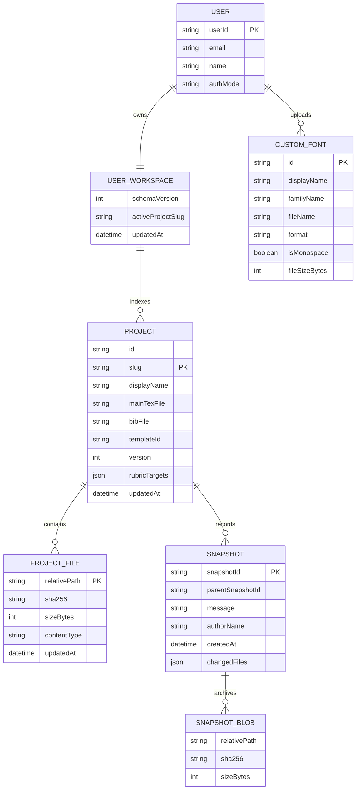
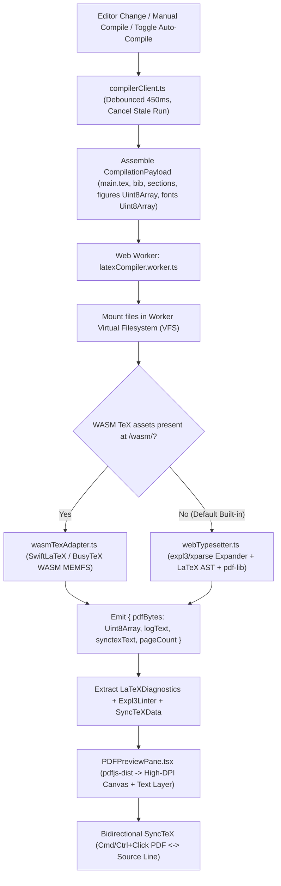

# LaTeXaP-WeB — Full-Stack System Architecture Specification

> **Status:** Architecture Approved for Implementation  
> **Target Repository:** `/Users/james/code/LaTeXaP-WeB`  
> **Reference Desktop Codebase:** `/Users/james/code/LaTeXaP` (macOS SwiftUI v0.3.2)

---

## 1. Executive Summary & Architectural Goals

**LaTeXaP-WeB** brings the complete **LaTeXaP** authoring experience (`expl3` + `xparse` LaTeX3 studio, real-time diagnostics, Plain-English Error Demystifier, Academic Paper Authoring Suite, custom fonts, and submission `.zip` + `.pdf` export) to a multi-user web platform with three cloud-native pillars:

1. **Multi-User Google Authentication**: Production Google Identity Services (GIS) ID-token verification (`OAuth2Client`) paired with signed `HttpOnly` JWT session cookies (`jose`), plus a seamless **Local Dev/Test Google Auth mode** when `GOOGLE_CLIENT_ID` is unset so automated tests and local evaluations work out-of-the-box with full multi-user isolation.
2. **Backblaze B2 Multi-Project Cloud Storage**: Scoped per-user cloud workspaces (`users/<userId>/projects/<projectSlug>/...`) accessed strictly through backend proxy endpoints using the Backblaze B2 S3-compatible API (`@aws-sdk/client-s3`)—keeping B2 application keys exclusively on the server—paired with a transparent **Local Filesystem B2 Fallback** when B2 environment variables are absent, and immutable per-project **Version Snapshots & History** analogous to LaTeXaP v0.3.0.
3. **100% Client-Side Web PDF Rendering**: Compilation and PDF generation execute entirely in the browser inside a dedicated **Web Worker** (`latexCompiler.worker.ts`) with an in-memory Virtual Filesystem (`VFS`), supporting a pluggable **WebAssembly TeX adapter** (`SwiftLaTeX`/`BusyTeX`) alongside a built-in zero-dependency **Web LaTeX3 Typesetter + `pdf-lib` PDF Emitter** that outputs genuine `%PDF-1.7` binaries, bidirectional **SyncTeX** coordinate maps, and structured TeX diagnostics—rendered in-browser via **`pdfjs-dist`**.

---

## 2. High-Level System Architecture



---

## 3. Feature Parity Map: macOS LaTeXaP → LaTeXaP-WeB

| LaTeXaP Desktop Feature | Source Reference in `../LaTeXaP` | LaTeXaP-WeB Implementation |
| :--- | :--- | :--- |
| **LaTeX3 (`expl3` + `xparse`) Editor & Themes** | `LaTeXCodeEditorView.swift` | CodeMirror 6 StreamLanguage/Lezer grammar for `expl3` (`\l_*_tl`, `\module_func:Npn`, `\ExplSyntaxOn`), `xparse`, math, comments; Light/Dark segmented theme toggle (`☀️ Light \| 🌙 Dark`); 10–24 pt font picker |
| **Line Autocompletion & Ghost Text** | `LaTeXAutoComplete.swift` | CodeMirror `autocompletion` source for `expl3`/`xparse`, `\begin{...}` environment expansion, `\usepackage{...}` catalog, `fontspec` custom fonts, and live document `\label`/`\cite`/macro indexing |
| **Structure Outline** | `LaTeXModels.swift` (`OutlineParser`) | `outlineParser.ts` extracting `\part`, `\chapter`, `\section`, `\subsection`, `\subsubsection`, `\NewDocumentCommand`, `\cs_new*`, `\NewDocumentEnvironment` with forward SyncTeX jump |
| **Diagnostics & Plain-English Error Demystifier** | `ContextSuggestionsEngine.swift` | `contextSuggestions.ts` (`analyze` + `demystify`) producing region-aware guidance, plain-English error cards, and 1-click `AcademicFixOperation` source mutations |
| **Academic Templates & Paper Setup Wizard** | `LaTeXTemplates.swift`, `PaperWizardSheetView.swift` | `latexCatalog.ts` (10 templates: `expl3-showcase`, `academic-paper`, `python-scientific`, `tikz-graphics`, `apa7-student`, `ieee-conference`, `acm-article`, `mla-essay`, `stem-lab-report`, `university-thesis`, `beamer-slides`) + `PaperWizardModal.tsx` |
| **Smart Citations & `.bib` Manager** | `BibliographyService.swift`, `CitationPickerPopoverView.swift` | `citationProxyService.ts` + `bibliographyParser.ts` + `CitationPickerPopover.tsx` (`\cite`, `\parencite`, `\textcite`, `\autocite`, `\footcite`, page locators, `APA`/`IEEE`/`ACM`/`MLA`/`Chicago`/`Nature` switcher, drag-and-drop `.bib`) |
| **Visual Table Grid, `pgfplots` Chart & Figure Assistant** | `AcademicToolsGenerator.swift`, `VisualToolsSheetView.swift`, `FigureAssistantSheetView.swift` | `academicToolsGenerator.ts` + `VisualToolsModal.tsx` (2D spreadsheet -> `booktabs`, CSV -> `pgfplots`, math snippets) + `FigureAssistantModal.tsx` (uploads into project `figures/`, single & `subcaption` side-by-side) |
| **Pre-Flight Linter, Rubric Budgets & Prose Spellcheck** | `AcademicPreflightService.swift`, `Expl3Linter.swift`, `LaTeXSpellCheckService.swift` | `academicPreflight.ts`, `expl3Linter.ts` (`computeAcademicStatistics`, Student Mode `studentModeHideExpl3`), `spellCheckService.ts` (prose-masked dictionary check ignoring preamble/math/`expl3`/commands) |
| **Custom Fonts & Specimen Preview** | `FontLibraryService.swift`, `FontManagerView.swift` | Per-user B2 `fonts/` storage + browser `FontFace` registration for live `10–36 pt` specimens + VFS staging for client-side PDF compilation + CTAN presets (`libertinus`, `ebgaramond`, `fira`, `plex`, `lmodern`, `tgpagella`) |
| **Multi-Project Cloud Storage & Version History** | `GitRepositoryService.swift`, `ProjectHistorySheetView.swift` | Backblaze B2 `users/<userId>/projects/<slug>/` + `.snapshots/` immutable version log, `Ctrl/Cmd+S` auto-snapshot, custom snapshot message popover, visual diff/restore, and conflict resolution |
| **Submission `.zip` & `.pdf` Export** | `SubmissionExportService.swift` | Client-side `submissionExport.ts` using `fflate` to bundle `main.tex`, `\input` subfiles, `references.bib`, `figures/`, and custom fonts (with optional comment strip & anonymization), plus direct `.pdf` download |

---

## 4. Multi-User Google Authentication Architecture

### 4.1 Auth Modes & Security Guarantees

1. **Google Production Mode** (active when `GOOGLE_CLIENT_ID` is configured):
   - Frontend loads Google Identity Services (`https://accounts.google.com/gsi/client`) using the public `GOOGLE_CLIENT_ID` returned by `GET /api/auth/config`.
   - User completes Google Sign-In and receives an OIDC `credential` (ID Token JWT).
   - Frontend posts `{ idToken }` to `POST /api/auth/google`.
   - Backend verifies the ID Token via `google-auth-library` (`OAuth2Client.verifyIdToken`), checking `audience === GOOGLE_CLIENT_ID`, valid issuer (`accounts.google.com` / `https://accounts.google.com`), and `email_verified === true`.
   - Canonical `userId` is derived deterministically from Google's immutable `sub`: `google_${sub}` (sanitized to `[a-zA-Z0-9_-]`).

2. **Seamless Local Dev/Test Mode** (active when `GOOGLE_CLIENT_ID` is unset, or `ALLOW_DEV_AUTH=true` outside production):
   - `GET /api/auth/config` returns `{ googleClientId: null, devAuthEnabled: true }`.
   - UI renders a **"Continue with Google (Local Dev Mode)"** login screen with one-click test user personas (`ada@latexap.dev`, `gauss@latexap.dev`) plus custom email/name inputs so multi-user isolation can be tested without external Google credentials.
   - `POST /api/auth/dev-login` accepts `{ email, name }` and computes a deterministic `userId = "dev_" + sha256(email.toLowerCase()).slice(0, 16)`.
   - **Hard Safety Guard**: If `NODE_ENV === "production"` and `GOOGLE_CLIENT_ID` is set (and `ALLOW_DEV_AUTH !== "true"`), `/api/auth/dev-login` returns `403 Forbidden`.

3. **Session Management & Tenant Isolation**:
   - Both flows mint a signed HS256 JWT (`jose`) stored in an `HttpOnly`, `SameSite=Lax`, `Path=/` cookie (`latexap_session`, `Secure` when `NODE_ENV === "production"`).
   - `JWT_SECRET` defaults to an ephemeral startup random 32-byte key in local dev (with a console warning) and requires an explicit env var in production.
   - Every protected route uses `requireAuth`, which attaches `req.user = { userId, email, name, picture, authMode }`.
   - **Strict Isolation**: Storage keys are *always* constructed server-side from `req.user.userId`; client payloads never specify a `userId`.

### 4.2 Authentication Sequence Diagram



---

## 5. Backblaze B2 Cloud Project Storage & Version Snapshots

### 5.1 Dual-Driver Storage Abstraction (`StorageProvider`)

To guarantee zero credential leakage and frictionless local testing, all persistence flows through a single `StorageProvider` interface in `server/services/storage/storageProvider.ts`:

- **`B2S3StorageProvider`** (activated when `B2_BUCKET_NAME`, `B2_ENDPOINT`, `B2_KEY_ID`, `B2_APPLICATION_KEY` are all set):
  - Uses `@aws-sdk/client-s3` configured for Backblaze B2's S3-compatible endpoint (`forcePathStyle: true`, region parsed from endpoint, e.g. `us-west-004`).
  - Supports `putObject`, `getObject`, `headObject`, `deleteObject`, `deletePrefix`, and `listObjects` with ETags and content-type metadata.
- **`LocalFilesystemB2FallbackProvider`** (activated automatically when B2 env vars are absent):
  - Mirrors the exact object key hierarchy under `STORAGE_LOCAL_DIR` (default `./.data/b2-local-storage/`).
  - Implements deterministic SHA-256 ETags, atomic temp-file writes (`writeFile` + `rename`), symlink rejection, and strict path containment (`path.resolve` prefix check) so behavior is 100% identical to B2 S3 in tests and local dev.

### 5.2 Backblaze B2 Object Key Schema & Data Model

```text
<B2 Bucket Root> (or .data/b2-local-storage/)
└── users/
    └── <userId>/                                     # e.g. google_108293... or dev_a1b2c3d4...
        ├── workspace.json                            # UserWorkspaceManifest
        ├── fonts/
        │   ├── fonts.json                            # FontLibraryManifest
        │   └── <fontId>-<sanitizedFileName>.ttf      # Custom font binaries (.ttf/.otf/.ttc, <= 64MB)
        └── projects/
            └── <projectSlug>/                        # ^[a-z0-9]+(-[a-z0-9]+)*$, max 64 chars
                ├── project.json                      # AcademicProjectDescriptor + version counter
                ├── main.tex                          # Primary LaTeX source
                ├── references.bib                    # Managed BibTeX database
                ├── sections/
                │   └── <subfile>.tex                 # Optional \input{} subfiles
                ├── figures/
                │   └── <sanitizedImage>.png          # Relative image assets (<= 50MB)
                └── .snapshots/
                    ├── index.json                    # SnapshotIndex (ordered newest-first)
                    └── <snapshotId>/                 # e.g. snap_176349..._abcd
                        ├── manifest.json             # SnapshotManifest (message, createdAt, changedFiles, parentId)
                        └── files/
                            ├── main.tex
                            ├── references.bib
                            └── figures/<image>.png
```

### 5.3 Entity-Relationship Diagram



### 5.4 Versioning, Optimistic Concurrency & Conflict Recovery

- **Quick Save & Snapshot (`Ctrl/Cmd+S`)**:
  - Client sends `PUT /api/projects/:slug/save` with modified text files (`main.tex`, `references.bib`, `sections/*.tex`), `expectedVersion`, and optional `message`.
  - Server hashes incoming files against stored files; if no content changed, it returns `200 OK` without creating an empty metadata-only snapshot (mirroring LaTeXaP v0.3.0 fix).
  - If content changed and `project.version === expectedVersion`, server atomically updates files, writes `.snapshots/<snapshotId>/manifest.json` + file copies, increments `project.version`, and returns `{ project, snapshot }`.
  - Default automatic message: `Update <Project Name> — YYYY-MM-DD HH:mm`.
- **Conflict Detection (`409 Conflict`)**:
  - If another browser tab/session saved first (`project.version !== expectedVersion`), server responds `409 Conflict` with `{ serverVersion, serverFiles, conflictFiles }`.
  - UI displays `ConflictResolutionBanner.tsx` offering:
    1. **Keep Both Copies**: Writes conflicting server file as `<stem>-cloud.<ext>` in the project and saves local changes as a new version.
    2. **Keep My Local Version**: Saves local files with `forceOverwrite: true` creating a new forward snapshot.
    3. **Use Cloud Version**: Discards conflicting local edits and reloads the cloud state.
- **Version History & Forward Restore (`Alt+Ctrl/Cmd+H`)**:
  - `GET /api/projects/:slug/snapshots` lists all snapshots.
  - `GET /api/projects/:slug/snapshots/:snapshotId` returns snapshot file contents and line-by-line diff against current working files.
  - `POST /api/projects/:slug/snapshots/:snapshotId/restore` restores project files to that snapshot and creates a **new forward snapshot** (`Restore "<Project>" to <shortId>`) so history remains non-destructive.

---

## 6. Client-Side Web PDF Compilation & Rendering Pipeline

### 6.1 Pipeline Overview

All compilation and PDF generation runs **entirely in the browser** inside `client/src/engine/latexCompiler.worker.ts`, ensuring zero server CPU bottleneck, instant offline feedback, and full privacy of draft documents.



### 6.2 Dual-Mode Worker Compiler Design

1. **Built-in Client-Side `webTypesetter.ts` (`pdf-lib` + `expl3`/`xparse` Expander)**:
   - Guarantees 100% offline, zero-external-CDN compilation for all templates, tests, and local deployments.
   - **Pre-processor / `expl3` & `xparse` Engine**:
     - Parses `\ExplSyntaxOn ... \ExplSyntaxOff` blocks, evaluates `\int_eval:n`, `\fp_eval:n`, `\tl_new:N`, `\tl_set:Nn`, `\tl_use:N`, `\seq_set_from_clist:Nn`, `\seq_map_inline:Nn`, `\NewDocumentCommand`, `\NewDocumentEnvironment`, and `\newcommand`.
     - Reports unmatched braces, missing `\documentclass`, missing `\begin{document}`, undefined control sequences, and unclosed environments as real TeX-style log entries with exact 1-based line numbers!
   - **Document Layout & PDF Emitter (`pdf-lib`)**:
     - Honors `\documentclass` options (`10pt`/`11pt`/`12pt`, `a4paper`/`letterpaper`, `twocolumn`), `\usepackage{setspace}` (`\doublespacing`), `\usepackage{lineno}` (`\linenumbers`), `\title`, `\author`, `\date`, `\maketitle`, `\begin{abstract}`, `\part`/`\chapter`/`\section`/`\subsection`/`\subsubsection` auto-numbering, `itemize`/`enumerate`, `booktabs` tables, `pgfplots` vector line/bar/scatter plots drawn with `pdf-lib` vector primitives, math equations rendered cleanly, embedded PNG/JPEG `\includegraphics` figures (from VFS `figures/`), embedded custom `.ttf`/`.otf` fonts (from VFS `fonts/` via `@pdf-lib/fontkit` or standard PDF font metrics fallback), and formatted bibliography sections resolving `\cite`/`\parencite`/`\textcite` against `references.bib`!
   - **SyncTeX Emitter**:
     - For every laid-out text run, heading, table row, equation, and figure drawn onto a PDF page, records exact `(page, inputID, sourceLine, xPt, yTopPt, widthPt, heightPt, depthPt)` in standard SyncTeX text format (`Input:1:main.tex`, `{1`, `h1,42:...`) so `synctexParser.ts` handles both `webTypesetter` and `WASM TeX` outputs identically!

2. **Optional WASM TeX Adapter (`wasmTexAdapter.ts`)**:
   - Probes `/wasm/swiftlatexpdftex.wasm` (or configured `VITE_WASM_TEX_URL`). When present, runs the Emscripten TeX worker with `VFS` mounted into `MEMFS`, returning native TeX `.pdf`, `.log`, and `.synctex` output through the exact same `CompilerResult` contract.

### 6.3 Bidirectional SyncTeX & PDF.js Viewer (`PDFPreviewPane.tsx`)

- **Rendering**: Uses `pdfjs-dist` (`GlobalWorkerOptions.workerSrc` bundled via Vite) to render each page of `pdfBytes` onto `<canvas>` scaled by `devicePixelRatio * zoomLevel`, plus a transparent selectable text layer and SyncTeX highlight overlay.
- **Forward Sync (`Shift+Cmd/Ctrl+J` or Outline Click)**: Calls `syncTeXData.forwardSearch(cursorLine)` -> scrolls `PDFPreviewPane` to `box.page` and animates a translucent blue highlight pulse at `(box.xPt, box.yTopPt, box.widthPt, box.heightPt)`.
- **Backward Sync (`Cmd/Ctrl+Click` or Double-Click on PDF Page)**: Converts click CSS coordinates on page canvas into PDF points `(xPt, yTopPt)` -> calls `syncTeXData.backwardSearch(page, xPt, yTopPt)` -> moves CodeMirror cursor and scrolls editor to the returned 1-based line!

---

## 7. Security & Input Validation Rules

Ported directly from `LaTeXaP`'s security hardening (`AcademicSanitizer`, `GitHubWorkspaceValidator`, `FontLibraryService`):

1. **Path Traversal & Symlink Containment**:
   - Project slugs must match `^[a-z0-9]+(-[a-z0-9]+)*$` (1–64 chars).
   - Project relative paths (`main.tex`, `references.bib`, `sections/*.tex`, `figures/*`) reject leading `/`, `\`, `..`, `:`, `\0`, control characters, or hidden dotfiles (`.git`, `.env`).
   - Allowed figure extensions: `png`, `jpg`, `jpeg`, `pdf`, `svg`, `webp`; max 50 MB per asset.
   - Allowed font extensions: `ttf`, `otf`, `ttc`; max 64 MB per font; validated header magic bytes (`0x00010000`, `OTTO`, `ttcf`, `true`).
2. **TeX Injection Sanitization (`AcademicSanitizer`)**:
   - Neutralizes dangerous primitives (`\write18`, `\immediate`, `\openout`, `\newwrite`, `\catcode`, `\@@input`, `\directlua`, `\ShellEscape`) and escapes metacharacters (`&`, `%`, `$`, `#`, `_`, `{`, `}`, `~`, `^`, `\`) in Wizard, Table, Chart, Figure, and CrossRef metadata.
3. **Network & Proxy Safety (`citationProxyService.ts`)**:
   - Server-side CrossRef/arXiv/OpenLibrary lookups enforce an explicit HTTPS host allowlist (`api.crossref.org`, `export.arxiv.org`, `openlibrary.org`), 8-second timeout, and 2 MB max response size.
4. **Secret Hygiene**:
   - `B2_APPLICATION_KEY`, `B2_KEY_ID`, and `JWT_SECRET` exist strictly in `server/config.ts` and are never serialized to API responses or client bundles.

---

## 8. Backend REST API Contracts

All `/api/*` routes (except `/api/health` and `/api/auth/*`) require a valid `latexap_session` cookie (`401 Unauthorized` otherwise).

### 8.1 Authentication (`/api/auth`)

| Method | Path | Request Body / Query | Response (`200 OK`) | Notes |
| :--- | :--- | :--- | :--- | :--- |
| `GET` | `/api/health` | — | `{ ok, storageDriver, devAuthEnabled, timestamp }` | Public health check |
| `GET` | `/api/auth/config` | — | `{ googleClientId: string \| null, devAuthEnabled: boolean, storageDriver: "b2" \| "local" }` | Public auth discovery |
| `POST` | `/api/auth/google` | `{ idToken: string }` | `{ user: AuthUser }` | Verifies Google OIDC token, sets `latexap_session` |
| `POST` | `/api/auth/dev-login` | `{ email: string, name?: string }` | `{ user: AuthUser }` | Enabled only in dev/test mode |
| `GET` | `/api/auth/me` | — | `{ user: AuthUser \| null }` | Returns current authenticated user |
| `POST` | `/api/auth/logout` | — | `{ ok: true }` | Clears `latexap_session` cookie |

### 8.2 Multi-Project Storage & Version Snapshots (`/api/projects`)

| Method | Path | Request | Response | Notes |
| :--- | :--- | :--- | :--- | :--- |
| `GET` | `/api/projects` | — | `{ workspace: UserWorkspaceManifest, projects: AcademicProjectDescriptor[] }` | Lists authenticated user's projects |
| `GET` | `/api/projects/storage/status` | — | `{ storageDriver: "b2" \| "local", bucketName: string, endpointRegion: string, userPrefix: string, connected: boolean, latencyMs?: number }` | Read-only B2/local diagnostics & connection test (never exposes keys) |
| `POST` | `/api/projects` | `{ displayName, slug?, templateId?, mainTexContent?, bibContent?, rubricTargets? }` | `201 { project, files }` | Creates `projects/<slug>/` + initial snapshot |
| `GET` | `/api/projects/:slug` | — | `{ project, files: Record<string, string>, binaryAssets: ProjectBinaryAsset[] }` | Loads text files + metadata for binary `figures/` |
| `PATCH` | `/api/projects/:slug` | `{ displayName: string }` | `{ project }` | Renames project display name |
| `POST` | `/api/projects/:slug/duplicate` | `{ displayName: string, slug?: string }` | `201 { project, files }` | Duplicates project files & figures into new slug |
| `DELETE` | `/api/projects/:slug` | — | `{ ok: true }` | Deletes project prefix in B2/local storage |
| `PUT` | `/api/projects/:slug/save` | `{ files: Record<string, string>, expectedVersion: number, message?: string, forceOverwrite?: boolean }` | `{ project, snapshot: SnapshotManifest \| null, skippedNoChanges: boolean }` | Atomic save + snapshot (`409` on version mismatch) |
| `POST` | `/api/projects/:slug/assets` | `multipart/form-data` (`file`, `targetDir="figures"`) | `201 { relativePath, sizeBytes, contentType, url }` | Uploads image into `figures/` |
| `GET` | `/api/projects/:slug/assets/*` | — | Binary stream (`image/png`, etc.) | Proxies binary figure from B2/local to browser VFS |
| `DELETE` | `/api/projects/:slug/assets/*` | — | `{ ok: true }` | Removes relative figure |
| `GET` | `/api/projects/:slug/snapshots` | — | `{ snapshots: SnapshotManifest[] }` | Lists version history newest-first |
| `GET` | `/api/projects/:slug/snapshots/:snapshotId` | — | `{ snapshot, files: Record<string, string>, diffs: FileDiffSummary[] }` | Inspect snapshot files & diffs vs current |
| `POST` | `/api/projects/:slug/snapshots/:snapshotId/restore` | — | `{ project, snapshot, files }` | Forward-restores files + records restore snapshot |
| `PATCH` | `/api/projects/:slug/rubric` | `RubricTargetConfig` | `{ project }` | Persists project rubric word/page targets |

### 8.3 Custom Fonts (`/api/fonts`) & Citations (`/api/citations`)

| Method | Path | Request | Response | Notes |
| :--- | :--- | :--- | :--- | :--- |
| `GET` | `/api/fonts` | — | `{ fonts: CustomFontRecord[] }` | Lists user's imported custom fonts |
| `POST` | `/api/fonts` | `multipart/form-data` (`file`, `displayName?`, `familyName?`, `isMonospace?`) | `201 { font: CustomFontRecord }` | Validates `.ttf`/`.otf`/`.ttc`, stores in B2 `users/<userId>/fonts/` |
| `PATCH` | `/api/fonts/:fontId` | `{ displayName: string }` | `{ font: CustomFontRecord }` | Renames font display name |
| `DELETE` | `/api/fonts/:fontId` | — | `{ ok: true }` | Deletes font file & updates `fonts.json` |
| `GET` | `/api/fonts/:fontId/binary` | — | Binary font stream (`font/ttf`, etc.) | Loaded by browser `FontFace` API + Worker VFS |
| `GET` | `/api/citations/search` | `?q=<query>&rows=10` | `{ entries: BibEntry[] }` | CrossRef search proxy |
| `GET` | `/api/citations/lookup` | `?identifier=<doi\|arxiv\|isbn>` | `{ entry: BibEntry }` | DOI / arXiv / ISBN resolver proxy |

---

## 9. Frozen Frontend State Contract (`useWorkspaceStore`)

`@ui-specialist` binds exclusively to `useWorkspaceStore()` (implemented by `@developer` in `client/src/state/useWorkspaceStore.ts`) and types in `shared/types/*.ts`:

```ts
export interface WorkspaceStore {
  // Auth & Environment
  authConfig: AuthConfig | null;
  currentUser: AuthUser | null;
  authLoading: boolean;
  authError: string | null;
  loginWithGoogleToken(idToken: string): Promise<void>;
  loginWithDevPersona(email: string, name?: string): Promise<void>;
  logout(): Promise<void>;

  // Multi-Project B2 Workspace & Snapshots
  projects: AcademicProjectDescriptor[];
  activeProject: AcademicProjectDescriptor | null;
  projectFiles: Record<string, string>; // "main.tex", "references.bib", "sections/..."
  binaryAssets: ProjectBinaryAsset[];
  storageStatus: StorageStatusInfo | null;
  isDirty: boolean;
  syncState: ProjectSyncState; // "idle" | "saving" | "saved" | "offline-fallback" | "conflict" | "error"
  conflictInfo: ProjectConflictInfo | null;
  snapshots: SnapshotManifest[];
  loadProjects(): Promise<void>;
  testStorageConnection(): Promise<StorageStatusInfo>;
  createProject(input: CreateProjectInput): Promise<void>;
  renameProject(slug: string, displayName: string): Promise<void>;
  duplicateProject(slug: string, displayName: string): Promise<void>;
  switchProject(slug: string): Promise<void>;
  deleteProject(slug: string): Promise<void>;
  saveProject(customMessage?: string): Promise<void>;
  resolveConflict(choice: ConflictResolutionChoice): Promise<void>;
  loadSnapshots(): Promise<void>;
  previewSnapshot(snapshotId: string): Promise<SnapshotDetail>;
  restoreSnapshot(snapshotId: string): Promise<void>;

  // Editor & Compilation State
  activeFilePath: string; // default "main.tex"
  sourceText: string;
  managedBibContent: string;
  cursorLine: number;
  autoCompileEnabled: boolean;
  editorTheme: "light" | "dark";
  editorFontFamily: string;
  editorFontSize: number;
  compilationState: CompilationState;
  pdfBytes: Uint8Array | null;
  synctexData: SyncTeXData | null;
  texLogText: string;
  diagnostics: LaTeXDiagnostic[];
  demystifiedDiagnostics: DemystifiedDiagnostic[];
  outlineItems: DocumentOutlineItem[];
  contextAdvice: { contextBadge: string; items: ContextAdviceItem[] };
  pendingInsertion: EditorInsertionRequest | null;
  pendingJumpToLine: { line: number; nonce: number } | null;
  forwardSyncBox: { box: SyncTeXBox; nonce: number } | null;

  setSourceText(text: string): void;
  setManagedBibContent(bib: string): void;
  setActiveFilePath(path: string): void;
  setCursorLine(line: number): void;
  setAutoCompileEnabled(enabled: boolean): void;
  setEditorTheme(theme: "light" | "dark"): void;
  setEditorTypography(family: string, size: number): void;
  compileNow(): Promise<void>;
  triggerForwardSync(line?: number): void;
  triggerBackwardSync(page: number, xPt: number, yTopPt: number): void;
  jumpToSourceLine(line: number): void;
  insertTextAtCaret(text: string, backtrackOffset?: number): void;
  consumePendingInsertion(): void;
  insertPackage(packageName: string, options?: string): void;

  // Academic Suite, Citations, Spellcheck & Export
  bibEntries: BibEntry[];
  bibSearchResults: BibEntry[];
  isSearchingCitations: boolean;
  selectedCitationStyle: CitationCommandStyle;
  selectedBibliographyStyle: BibliographyStylePreset;
  academicStats: AcademicDocumentStats;
  rubricTargets: RubricTargetConfig;
  preflightReport: AcademicPreflightReport;
  proseSpellCheckEnabled: boolean;
  spellingIssues: SpellingIssue[];

  searchCitations(query: string): Promise<void>;
  lookupCitationByIdentifier(identifier: string): Promise<void>;
  importBibEntry(entry: BibEntry): void;
  importBibFile(file: File): Promise<void>;
  insertFormattedCitation(entry: BibEntry, style: CitationCommandStyle, pageLocator?: string): void;
  applyBibliographyStyle(style: BibliographyStylePreset): void;
  applyPaperSetupWizard(config: PaperSetupConfig): Promise<void>;
  applyTemplate(templateId: string): void;
  applyAcademicFix(op: AcademicFixOperation): void;
  updateRubricTargets(targets: RubricTargetConfig): Promise<void>;
  toggleProseSpellCheck(enabled: boolean): void;
  applySpellingSuggestion(issue: SpellingIssue, replacement: string): void;
  ignoreSpellingWord(word: string): void;
  uploadAndInsertFigure(primaryFile: File, secondaryFile: File | null, config: FigureInsertConfig): Promise<void>;
  insertSpreadsheetTable(grid: TableGridData): void;
  insertPGFPlotChart(chart: PGFPlotChartConfig): void;
  exportCompiledPDF(): void;
  exportSubmissionZip(options?: { stripComments?: boolean; anonymize?: boolean }): Promise<SubmissionExportResult>;

  // Custom Fonts
  customFonts: CustomFontRecord[];
  uploadCustomFont(file: File, displayName?: string): Promise<CustomFontRecord>;
  renameCustomFont(fontId: string, displayName: string): Promise<void>;
  deleteCustomFont(fontId: string): Promise<void>;
  applyFontToDocument(fontNameOrFile: string, role: LaTeXFontRole, customCommandName?: string): void;
}
```

---

## 10. Strict Non-Overlapping File & Module Ownership Table

Neither `@developer` nor `@ui-specialist` may create or modify files assigned to the other. Shared types in `shared/types/` and `package.json` are owned by `@developer` and frozen once published.

| Owner | Action | Path / Pattern | Responsibility |
| :--- | :--- | :--- | :--- |
| **`@developer`** | Create | `package.json`, `tsconfig.json`, `tsconfig.server.json`, `vite.config.ts`, `.env.example`, `.gitignore`, `Dockerfile`, `.dockerignore`, `docker-compose.yml` | Project dependencies, build/dev/test scripts, multi-stage production Docker image (`node:22-alpine`), and Compose deployment configuration |
| **`@developer`** | Create | `shared/types/auth.ts`, `shared/types/project.ts`, `shared/types/latex.ts`, `shared/types/academic.ts`, `shared/types/fonts.ts`, `shared/types/api.ts`, `shared/types/index.ts` | Frozen domain models & API DTO contracts shared across server, worker, and UI |
| **`@developer`** | Create | `server/config.ts`, `server/app.ts`, `server/index.ts` | Express server setup, CORS/Helmet-style security headers, static prod SPA serving, env validation |
| **`@developer`** | Create | `server/middleware/authMiddleware.ts`, `server/middleware/errorMiddleware.ts` | `requireAuth` cookie JWT middleware, strict tenant scoping, safe error serializer |
| **`@developer`** | Create | `server/services/authService.ts`, `server/routes/authRoutes.ts` | Google OIDC ID token verification + Local Dev Auth mode + `HttpOnly` JWT session cookies |
| **`@developer`** | Create | `server/services/storage/storageProvider.ts`, `server/services/storage/b2S3StorageProvider.ts`, `server/services/storage/localStorageProvider.ts` | Backblaze B2 S3-compatible provider + transparent local filesystem fallback |
| **`@developer`** | Create | `server/services/projectService.ts`, `server/routes/projectRoutes.ts` | Multi-project CRUD, `workspace.json`/`project.json`, snapshots, diffs, forward restore, conflict detection, binary `figures/` endpoints |
| **`@developer`** | Create | `server/services/fontStorageService.ts`, `server/routes/fontRoutes.ts` | Per-user custom `.ttf`/`.otf`/`.ttc` validation, B2/local persistence, binary streaming |
| **`@developer`** | Create | `server/services/citationProxyService.ts`, `server/routes/citationRoutes.ts` | CrossRef / DOI / arXiv / ISBN HTTPS proxy with URL allowlist & 2 MB response limits |
| **`@developer`** | Create | `client/src/services/apiClient.ts` | Typed `fetch` API client with `credentials: "include"` |
| **`@developer`** | Create | `client/src/services/latexCatalog.ts`, `client/src/services/outlineParser.ts`, `client/src/services/expl3Linter.ts` | 10+ LaTeX/Academic templates, CTAN package & font presets, `OutlineParser`, `Expl3Linter`, `computeAcademicStatistics` |
| **`@developer`** | Create | `client/src/services/contextSuggestions.ts`, `client/src/services/academicPreflight.ts`, `client/src/services/academicToolsGenerator.ts` | Region-aware suggestions, plain-English Error Demystifier, Pre-Flight linter, `booktabs`/`pgfplots`/figure generators, `AcademicSanitizer` |
| **`@developer`** | Create | `client/src/services/bibliographyParser.ts`, `client/src/services/latexAutoComplete.ts`, `client/src/services/spellCheckService.ts`, `client/src/services/submissionExport.ts` | BibTeX parser/formatter, CodeMirror autocomplete provider, prose-masked spellchecker, `fflate` `.zip` + `.pdf` export |
| **`@developer`** | Create | `client/src/engine/synctexParser.ts`, `client/src/engine/wasmTexAdapter.ts`, `client/src/engine/webTypesetter.ts`, `client/src/engine/latexCompiler.worker.ts`, `client/src/engine/compilerClient.ts` | Client-side Web Worker LaTeX-to-PDF compiler (`webTypesetter` + `pdf-lib` + optional WASM TeX adapter), log/diagnostic extraction, bidirectional SyncTeX |
| **`@developer`** | Create | `client/src/state/useWorkspaceStore.ts` | React Context + Store provider implementing the frozen `WorkspaceStore` contract |
| **`@developer`** | Create | `tests/**/*.test.ts` | Vitest suite: Auth (Google + Dev isolation), B2 Local Fallback + Snapshots/Restore/Conflicts, Security validators, `webTypesetter` PDF + SyncTeX, `expl3` linter, Academic tools, `.zip` export |
| **`@ui-specialist`** | Create | `client/index.html`, `client/src/main.tsx`, `client/src/App.tsx` | SPA root shell, `WorkspaceProvider` mount, global keyboard shortcuts (`Cmd/Ctrl+S`, `Alt+Cmd/Ctrl+S`, `Cmd/Ctrl+B`, `Shift+Cmd/Ctrl+J`, `Shift+Cmd/Ctrl+N`, `Shift+Cmd/Ctrl+K`, `Shift+Cmd/Ctrl+F`, `Alt+Cmd/Ctrl+H`) |
| **`@ui-specialist`** | Create | `client/src/styles/tokens.css`, `client/src/styles/themes.css`, `client/src/styles/workspace.css` | Design tokens, macOS-inspired Light/Dark editor & studio surfaces, split-pane responsive CSS |
| **`@ui-specialist`** | Create | `client/src/components/auth/AuthGateView.tsx`, `client/src/components/auth/UserMenuPopover.tsx` | Google Sign-In + Dev Persona switcher UI, user profile badge, sign-out |
| **`@ui-specialist`** | Create | `client/src/components/layout/TopToolbar.tsx`, `client/src/components/layout/SidebarPanel.tsx`, `client/src/components/layout/StatusBar.tsx`, `client/src/components/layout/DiagnosticsDrawer.tsx` | Main toolbar (`Auto-Compile: ON/OFF` green capsule, Compile, Sync PDF, Project/History, Export), 6-tab + Advice sidebar, status bar with Rubric pill, bottom Diagnostics/Demystifier/Pre-Flight/Transcript drawer |
| **`@ui-specialist`** | Create | `client/src/components/editor/LaTeXCodeEditor.tsx`, `client/src/components/editor/EditorTypographyPopover.tsx` | CodeMirror 6 LaTeX3 (`expl3` + `xparse`) syntax highlighting, diagnostic gutter, spellcheck underlines, Light/Dark segmented pill, font/size popover |
| **`@ui-specialist`** | Create | `client/src/components/preview/PDFPreviewPane.tsx` | `pdfjs-dist` paginated canvas renderer, zoom/page controls, Auto-Compile badge, SyncTeX forward highlight & `Cmd/Ctrl+Click` backward jump |
| **`@ui-specialist`** | Create | `client/src/components/sidebar/OutlineTab.tsx`, `PackagesTab.tsx`, `FontsTab.tsx`, `BibliographyTab.tsx`, `SnippetsTab.tsx`, `TemplatesTab.tsx`, `ContextAdviceTab.tsx` | Sidebar panels for Outline, CTAN Packages, Fonts, BibTeX Library + Style Switcher, LaTeX3 Snippets, Templates, and Context Suggestions |
| **`@ui-specialist`** | Create | `client/src/components/projects/B2ProjectManagerModal.tsx`, `SnapshotSavePopover.tsx`, `ProjectHistoryModal.tsx`, `ConflictResolutionBanner.tsx` | Backblaze B2 project switcher/creator, custom snapshot message popover, visual commit/snapshot diff & restore modal, conflict banner |
| **`@ui-specialist`** | Create | `client/src/components/academic/PaperWizardModal.tsx`, `CitationPickerPopover.tsx`, `VisualToolsModal.tsx`, `FigureAssistantModal.tsx`, `PreflightChecklistView.tsx`, `RubricTargetsPopover.tsx`, `FontManagerModal.tsx` | Academic Paper Setup Wizard, Quick Citation Picker, 2D Spreadsheet Table & `pgfplots` Chart Builder, Relative Figure Assistant, Pre-Flight & Demystifier cards, Rubric Targets, Custom Font Manager with live specimen preview |

---

## 11. Implementation Sequencing for Parallel Execution

1. **Stage 1 (`@developer` Foundation)**:
   - Scaffold `package.json`, TypeScript/Vite configs, `shared/types/*`, backend server + Auth + B2/Local Storage, and stub/implement `useWorkspaceStore.ts` so TypeScript compilation succeeds cleanly.
   - Notify `@ui-specialist` and `@coordinator` on the board once `shared/types/*` and `useWorkspaceStore.ts` signatures are live in `/Users/james/code/LaTeXaP-WeB`.
2. **Stage 2 (Parallel Build)**:
   - **`@developer`**: Completes client-side Web Worker PDF compiler (`webTypesetter.ts` + `pdf-lib` + `wasmTexAdapter.ts` + `synctexParser.ts`), all Academic Suite / `expl3` / `fflate` services, `useWorkspaceStore.ts` logic, and full `vitest` test suite.
   - **`@ui-specialist`**: Builds the complete React UI (`AuthGateView`, split-pane CodeMirror 6 + `pdfjs-dist` viewer, all sidebar tabs, B2 project & snapshot history modals, Academic Suite modals/popovers, Font Manager) bound strictly to `useWorkspaceStore`.
3. **Stage 3 (Integration & Verification)**:
   - Run `npm run typecheck`, `npm run build`, `npm test`, and end-to-end verification (multi-user auth isolation, B2 local fallback snapshot/restore, client-side PDF generation + SyncTeX, Academic Suite export).

---

## 12. Containerized Deployment Architecture (Docker & Compose)

LaTeXaP-WeB ships with a multi-stage production container (`Dockerfile`), `.dockerignore`, and `docker-compose.yml`:

- **Multi-Stage `Dockerfile` (`node:22-alpine`)**:
  - **`builder` stage**: Installs full dependencies (`npm ci`) and runs `npm run build` (`vite build` → `dist-client/` + `tsc -p tsconfig.server.json` → `dist-server/`).
  - **`runner` stage**: Sets `NODE_ENV=production`, `PORT=4000`, `LOCAL_STORAGE_ROOT=/app/.local-b2-storage`, installs production-only dependencies (`npm ci --omit=dev`), copies `dist-client/` and `dist-server/`, creates `/app/.local-b2-storage` owned by `node:node`, runs as non-root `USER node`, exposes `4000`, and defines a Docker `HEALTHCHECK` polling `GET /api/health`.
- **`docker-compose.yml`**:
  - Defines the `latexap-web` service (`${PORT:-4000}:4000`), passes through `JWT_SECRET` (un-defaulted so production fails closed unless explicitly provided), `GOOGLE_CLIENT_ID`, `ALLOW_DEV_AUTH` (defaulting to `false` in production Compose), and Backblaze B2 credentials (`B2_KEY_ID`, `B2_APPLICATION_KEY`, `B2_BUCKET_NAME`, `B2_ENDPOINT`, `B2_REGION`).
  - Mounts persistent named volume `latexap_storage:/app/.local-b2-storage` for local-fallback mode when B2 credentials are omitted.
- **Health & Production SPA Serving (`server/app.ts`)**:
  - `GET /api/health` returns `200 OK` JSON (`{ ok: true, status: "ok", storageDriver, storageMode, devAuthEnabled, timestamp }`).
  - In `NODE_ENV=production`, Express serves static assets from `dist-client/` and falls back non-`/api/*` routes to `dist-client/index.html`, while unknown `/api/*` routes return JSON `404`.
